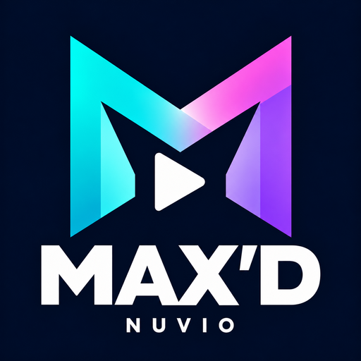

  

<h1 align="center">Nuvio Max'd</h1>

<strong>Your Nuvio library, profiles, addons and watch progress. On PS5.</strong>

  
  
  
  

  <strong>Latest published build: 0.5.31 · experimental</strong> 
  <a href="https://github.com/HandshakeHackin/Nuvio-maxd-releases/blob/builds/v0.5.31/USER_GUIDE.md">User guide</a> · <a href="https://github.com/HandshakeHackin/Nuvio-maxd-releases/releases/tag/v0.5.31-native-experimental">Downloads and release notes</a> · <a href="https://github.com/HandshakeHackin/Nuvio-maxd-releases/issues">Report a problem</a>

Bring your Nuvio setup to the big screen. Sign in with your phone, choose a
profile, browse addon catalogs and your saved library, and keep movie and episode
progress in sync with your other Nuvio devices. The interface and integrated
players run directly on the console; you do not need a PC running a companion server.

**0.5.31 adds a Continue Watching resilience fix, a provider-download socket fix,
tracker source choices and experimental playback improvements.** Read the
[changelog](CHANGELOG.md) and [testing notes](native-app/TESTING-0.5.31.md) for
setup and verification limits. The fixes for [#3](https://github.com/HandshakeHackin/Nuvio-maxd-releases/issues/3)
and [#4](https://github.com/HandshakeHackin/Nuvio-maxd-releases/issues/4) still need
affected-user PS5 confirmation. The store can lag behind GitHub; check its listed version.

## Library, profiles and sources

| Feature | What you can do |
| --- | --- |
| **Phone sign-in** | Scan the QR code to link your Nuvio account and keep the login between launches. Guest use is also available. |
| **Multiple profiles** | Choose, import or create up to six account profiles. Switch through **Settings → Account & Services → Profiles** after stopping playback. Account-backed PIN checks require a connection. |
| **Separate profile data** | Keep history, resume positions, source lists and preferences scoped to the selected profile. Addon/plugin repository lists and watched history sync; individual scraper switches remain local. Inherited sources are read-only here. |
| **Nuvio library and progress** | Browse saved titles and resume movies or episodes across devices using the same account and selected profile. Offline progress waits to sync when you reconnect. Guest progress stays on the PS5. |
| **Tracking accounts** | Optional Trakt, SIMKL and MDBList connections with separate Library Source and Watch Progress selections; Nuvio remains default. Trakt/SIMKL app credentials are required. |
| **Standard addons** | Load enabled addons from your Nuvio setup or add a manifest URL, including setups using AIOMetadata and AIOStreams. Compatibility depends on the addon. |
| **Provider plugins** | Add raw Nuvio JavaScript provider repository manifests and enable individual scrapers. Android DEX/CS3 plugins are not supported. |
| **Catalogs and search** | Browse artwork, search titles, choose seasons and read episode descriptions with thumbnails and progress bars. |
| **Stream selection** | Compare advertised resolution, HDR, language, codec, audio and file size; filter by addon. Your selection stays focused as results arrive. |
| **Connected services** | Connect TorBox or Premiumize, or explicitly import supported connections from Nuvio Sync, to resolve cached original files. Optional background link preparation reduces waiting after selection. |
| **Playback sources** | Play compatible direct/addon HTTP links. Peer-to-peer torrent playback is available separately and is off by default. |

To use a provider repository, open **Settings → Addons → Add addon or plugin URL**
and enter its raw `manifest.json` URL. Then select the repository on the **Addons**
page and enable a provider. Providers start disabled; try one first. A GitHub
directory URL is not a manifest. Some providers need unsupported APIs, extra
configuration or browser challenges, so installing a repository does not guarantee streams.

## Video, audio and subtitles

| Feature | What you get |
| --- | --- |
| **Native player by default** | Integrated playback for compatible H.264/HEVC and other supported media, with audio/subtitle track selection and playback details. |
| **Optional EVO and VLC engines** | Choose **EVO Player 0.12.0** or **VLC 3.0.24** under **Settings → Video → Playback engine**. Both are experimental; the choice applies to the next stream. They retain their own compatibility limits. |
| **Native-resolution GPU presentation** | Keep decoded picture dimensions, including compatible 4K sources, and convert YUV colour on the GPU. Source resolution is distinct from the actual HDMI signal. |
| **Display choices** | Follow the configured PS5 resolution or choose an override. Request **60 Hz** or **Prefer 120 Hz** on compatible outputs; refresh changes require an app restart. |
| **HDR choices** | Try experimental native HDR10 for compatible PQ/BT.2020 sources, or explicitly choose **Convert HDR to SDR**. Tone mapping preserves luminance and fits wide-gamut colours into SDR. HDR output needs console/TV confirmation. |
| **Audio output** | Decoded PCM by default, with stereo or optional surround PCM. Auto/bitstream output for compatible AC-3, E-AC-3 and DTS core is experimental. TrueHD/DTS-HD remain decoded PCM. Keep surround off for optical stereo or TV speakers. |
| **Preferred languages** | Set audio and subtitle language preferences. Automatic subtitles prefer suitable in-file tracks before addon subtitles; manual choices, including Off, are retained. |
| **Subtitle rendering** | Styled ASS/SSA and bitmap/PGS subtitles, Unicode fallback fonts and text shaping. Adjust size, font, colour, outline/shadow, background and timing; style controls include previews. |
| **Seeking and buffering** | Set D-pad and shoulder-button seek intervals separately. Native/EVO read-ahead choices are 30, 60, 120 or 300 seconds. Seeking and network-recovery changes include HLS handling, with remaining engine-specific limits. |

**EVO is an integrated video engine here, not the entire standalone EVO app.**
Nuvio retains its interface and, for Native/EVO, its audio output, OpenGL renderer
and HDR composition. Choosing EVO alone does not replace the complete output path.
VLC is an optional integrated engine and still needs console testing.

Native HDR10 can be rejected by the console/output combination. HDR10+ dynamic
metadata, full Dolby Vision processing and forwarding source mastering metadata
are not supported. A source's HDR/audio badges do not prove that the TV or
receiver is receiving those formats. 120 Hz can improve film cadence but does
not add motion interpolation or guarantee smooth playback.

## Watching and everyday use

- **Skip Intro, Recap and Credits:** controller-button prompts appear when IntroDB
  supplies episode timings. Known post-credit scenes are preserved; missing
  timings leave playback unchanged.
- **Next-episode autoplay:** prepare the next episode and offer a cancellable,
  adjustable countdown when a matching stream is ready. Pause/buffering holds the
  countdown, and autoplay can be turned off.
- **Controller and Media Remote controls:** DualSense navigation plus supported
  PS5 Media Remote/HDMI-CEC navigation and playback controls.
- **Organized settings:** Account & Services, Video, Audio, Subtitles, Playback,
  Appearance & Lighting, Addons, and App & Updates.
- **Appearance and accessibility:** reduced motion, higher contrast, calmer
  backgrounds and optional interface sounds. These settings do not change video colours.
- **Logo-inspired lighting:** a slow teal → white → pink/purple controller-light
  fade. Optional **Console light sync** follows it on supported systems, with
  approximate colours and a disable switch that restores the previous state.
  Unsupported systems leave console lighting unchanged.
- **What's new:** a simple changelog after a version change, available again in Settings.
- **Update reminders:** choose Homebrew Store, GitHub/manual, or Not sure as your
  install source. Reminders direct you to the appropriate update location; this
  is a saved choice, not automatic installer detection.
- **In-app update checks:** check the public feed in Settings. Verified FFPFSC
  installation through the bundled helper is experimental; ZIP installs use
  manual replacement. Keep app data when updating.
- **Playback diagnostics:** view log locations and collect playback, frame-timing,
  startup and crash information for troubleshooting. Remove tokens, passwords,
  authorization headers and stream URLs before sharing logs.
- **Optional support:** a Ko-fi link and QR code in Settings. Donations are optional.

## What changed in 0.5.31

- **Continue Watching:** valid entries remain visible and cached when one synced
  record cannot be read. Incomplete snapshots cannot delete or replace cloud
  history ([#4](https://github.com/HandshakeHackin/Nuvio-maxd-releases/issues/4)).
- **Provider downloads:** a PS5 socket-mode fix targets the logged curl 1 / Unsupported
  protocol failure ([#3](https://github.com/HandshakeHackin/Nuvio-maxd-releases/issues/3)).
  This remains a candidate fix pending the reporter's console test.
- **Trakt, SIMKL and MDBList:** per-profile connections, independent Library Source
  and Watch Progress choices, offline retry and temporary Nuvio fallback
  ([#2](https://github.com/HandshakeHackin/Nuvio-maxd-releases/issues/2)). Defaults
  remain Nuvio; connecting a tracker does not select it automatically.
- **Playback:** BGR-first in-place HDR switching, low-rate Native/EVO pacing at
  accepted 120 Hz, GPU texture safeguards and a PCM recovery race fix, with
  credited adaptations from [ProsperoTube](https://github.com/blackbearreloaded/ProsperoTube).
  VLC does not use the new scheduler. Physical PS5/HDMI validation remains pending.

Open **Settings → Account & Services → Tracking accounts** to connect a tracker.
Trakt/SIMKL require registered application credentials; this release does not
bundle shared registrations. MDBList uses a personal API key. Read the
[tracking guide](native-app/TRACKING-0.5.31.md) before connecting.
Trakt/MDBList library reads use watchlists and SIMKL uses its tracked library;
custom external lists are not included.

76 account/sync tests pass, and live account reads matched the expected resume
titles for each profile. That account did not contain unreadable records; PS5 UI,
reporter-specific and cross-device write verification remain outstanding.
See the [changelog](CHANGELOG.md), [testing guide](native-app/TESTING-0.5.31.md)
and [release history](https://github.com/HandshakeHackin/Nuvio-maxd-releases/releases).
Earlier releases added multiple profiles, provider plugins, embedded-subtitle
preference, categorized settings, lighting, update reminders and optional players.

## Download and install

You need a jailbroken PS5 and compatible homebrew payloads, including a suitable
kstuff setup and [ShadowMount+](https://github.com/drakmor/ShadowMountPlus).
Follow the loader's instructions for your firmware. The project targets firmware
9.00 and above where those tools work; coverage is incomplete and firmware below
9.00 needs further testing. Homebrew loader compatibility does not establish
HDR/audio compatibility.

| Published 0.5.31 download | Installation |
| --- | --- |
| [**PPSA99288.zip**](https://github.com/HandshakeHackin/Nuvio-maxd-releases/releases/download/v0.5.31-native-experimental/PPSA99288.zip) | Extract and copy the complete `PPSA99288/` folder into a location scanned by ShadowMount+, such as `/data/homebrew/`. The executable should be `/data/homebrew/PPSA99288/eboot.bin`, with no extra folder level. |
| [**NuvioMaxd-0.5.31-native.ffpfsc**](https://github.com/HandshakeHackin/Nuvio-maxd-releases/releases/download/v0.5.31-native-experimental/NuvioMaxd-0.5.31-native.ffpfsc) | Place the image in a homebrew folder on storage scanned by ShadowMount+. |

Use one installation format at a time. Close the app before replacing an image
or folder, preserve your app data, and let ShadowMount+ finish scanning before
launching. The title ID remains **PPSA99288**. Downloads include matching source,
checksums and validation evidence.

After launch, scan the account QR code or continue as Guest. For cross-device
resume, use the same Nuvio account/profile on each device and select Nuvio Sync
as the progress source on the other device. Configure addons normally; connect
TorBox/Premiumize separately if you want their cached-file resolution.

The [published-build user guide](https://github.com/HandshakeHackin/Nuvio-maxd-releases/blob/builds/v0.5.31/USER_GUIDE.md)
covers controls, setup and troubleshooting. Check the version on the
[ProsperoStore listing](https://homebrew.page/app/PPSA99288/): catalog submission,
maintainer approval and live deployment happen separately from a GitHub release.

## Report a problem

[Open an issue](https://github.com/HandshakeHackin/Nuvio-maxd-releases/issues) with
your app version, firmware, playback engine, steps and expected/actual behavior.
For provider-download failures, enable one provider, reproduce the problem and
include the complete `provider: script download failed` log line. Shared logs
must exclude credentials and stream URLs. Please reply to an existing matching
issue rather than opening a duplicate.

See the published [playback limits](https://github.com/HandshakeHackin/Nuvio-maxd-releases/blob/builds/v0.5.31/source/native-app/PLAYBACK_QUALITY.md)
and [update guide](https://github.com/HandshakeHackin/Nuvio-maxd-releases/blob/builds/v0.5.31/source/native-app/UPDATING.md).

## Source and credits

Nuvio Max'd is an **unofficial client**, previously named Nuvio PS5. It is not
affiliated with Nuvio, Stremio or Sony. The project is distributed under the
[GPL-3.0 license](LICENSE); included components retain their own notices.

Every published release includes its matching source archive. Browse the
[0.5.31 source](https://github.com/HandshakeHackin/Nuvio-maxd-releases/tree/builds/v0.5.31/source/native-app),
[build guide](https://github.com/HandshakeHackin/Nuvio-maxd-releases/blob/builds/v0.5.31/source/native-app/README.md)
and [third-party notices](https://github.com/HandshakeHackin/Nuvio-maxd-releases/blob/builds/v0.5.31/source/native-app/THIRD_PARTY.md).
Versioned delivery branches use `builds/v<VERSION>`. The homepage may describe
newer local work; the release tag and matching source identify each public build.

Nuvio branding and account protocols come from
[NuvioTVSmart](https://github.com/NuvioMedia/NuvioTVSmart). The native UI and
integrated player are adapted from
[Sp9nky's unofficial Stremio port](https://github.com/Sp9nky/unofficial-stremio-ps5-port),
using [BlackBearReloaded's Prospero UI](https://github.com/blackbearreloaded/ps5-homebrew-ui),
the credited EVO/VLC and media libraries, and the other components listed in the
notices. The 0.5.31 playback work also adapts ProsperoTube's scheduler and
output-lifetime approach with its source and license attribution retained.
