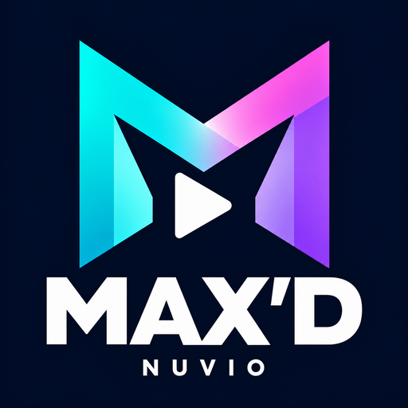

  

<h1 align="center">Nuvio Max'd</h1>

<strong>Your Nuvio library, live TV and watch progress — on PS5.</strong>

  <a href="https://prosperostore.net/app/PPSA99288/">Homebrew Store</a> ·
  <a href="https://github.com/HandshakeHackin/Nuvio-maxd-releases/releases/tag/v1.0.0.25-native">Downloads and release notes</a> ·
  <a href="https://github.com/HandshakeHackin/Nuvio-maxd-releases/issues">Report a problem</a>

**Official release: 1.0.0.25**

Nuvio Max'd runs directly on a jailbroken PS5. Sign in with your phone or use
Guest mode, then browse your library, addons, TV playlists and media servers.
No companion PC app is required.

## What's new

- **Better seeking**, including paused seeks and changing the seek target.
- **Subtitle fixes**, updated fonts and correct Arabic font selection.
- **Refreshed playback engines, providers and connection security.**
- **MDBList fixes retained:** library syncing, watched indicators and episode-carousel position.

See the [full release notes](https://github.com/HandshakeHackin/Nuvio-maxd-releases/blob/v1.0.0.25-native/RELEASE_NOTES.md) for the detailed changelog.

## Library, profiles and discovery

- **Profiles and sync:** up to six profiles, PIN entry, and library/watch progress synced across Nuvio devices.
- **Title actions:** add/remove titles and mark movies or episodes watched. Season/show changes ask for confirmation.
- **Trakt, SIMKL and MDBList:** separate library and watch-progress choices. SIMKL library browsing is read-only.
- **People and trailers:** browse cast/crew biographies and credits, discover related titles and watch supported trailers.
- **Search and sources:** library search, new-episode badges, stream details and saved source preferences.

## Live TV and your own media

- **Live TV:** M3U/M3U8 playlists, Xtream Codes and Stalker/Ministra portals, with groups, search and favorites.
- **USB import:** copy playlists into the selected profile. USB access may need the bundled helper and a compatible payload loader.
- **TV guide:** Now/Next information from your provider or XMLTV.
- **IPTV Library:** browse provider movies/series, search saved catalogs and resume locally.
- **Optional Sports Hub:** follow leagues/teams, hide score spoilers and find possible matching TV channels.
- **Experimental multiview:** four SDR channels at once, with one selected for sound. Requires four provider connections.
- **Media servers:** connect Plex, Jellyfin or Emby.
- **Addons and providers:** Nuvio manifests, supported JavaScript providers, and cached-file access through TorBox/Premiumize.
- **Experimental torrents and Web Drop:** send magnet links or torrent files from a paired phone/PC browser. Enable torrent mode first; it is off by default.

Addons, playlists and media access come from your own sources and accounts.
Availability depends on the provider.

## Playback

- **Three player choices:** Native is the default, with optional **EVO Player 0.13.7** and **VLC 3.0.24** engines.
- **Audio and subtitles:** track/language selection, stereo or surround audio, volume/sync controls and subtitle styling.
- **Episode controls:** IntroDB/AniSkip timings, Skip Intro/Recap/Credits and optional next-episode autoplay with an adjustable countdown.
- **Chapters and seeking:** embedded chapter selection and custom seek intervals.
- **Picture settings:** compatible 4K playback, experimental HDR10, HDR-to-SDR conversion and optional 120 Hz output.
- **TVDB episode ordering:** choose supported alternate series orders using your own TVDB API access, while preserving watch-history identity.

Optional engines, HDR and 120 Hz depend on your console, display and media.
Full Dolby Vision and HDR10+ are not supported. See the
[playback limits](https://github.com/HandshakeHackin/Nuvio-maxd-releases/blob/v1.0.0.25-native/source/native-app/PLAYBACK_QUALITY.md)
for format details.

## Languages, controls and backups

- **Eight menu languages:** English, German, Spanish, French, Arabic, Simplified Chinese, Japanese and Korean. Change **Settings → App & Updates → Language**, then restart. Advanced help may use English.
- **Controls:** DualSense, supported Media Remote/HDMI-CEC buttons and app-local remote remapping. System-intercepted buttons cannot be reassigned.
- **Appearance:** settings search, reduced motion, higher contrast, interface sounds and controller lighting. Console light sync is optional on supported systems.
- **Encrypted backups:** save profile settings and imported USB playlists, up to 16 MiB. Account sessions, watched history and resume are excluded.
- **Google Drive:** optional manual backup sync with conflict review. Requires your own compatible Google app registration; none is bundled.

## Download and install

You need a jailbroken PS5 and a compatible
[ShadowMount+](https://github.com/drakmor/ShadowMountPlus) setup. Follow the
loader's instructions for your firmware.

| Download | Install |
| --- | --- |
| [**Homebrew Store**](https://prosperostore.net/app/PPSA99288/) | Find **Nuvio Max'd** and install the listed build. |
| [**ZIP folder**](https://github.com/HandshakeHackin/Nuvio-maxd-releases/releases/download/v1.0.0.25-native/PPSA99288.zip) | Extract `PPSA99288/` into a folder scanned by ShadowMount+, such as `/data/homebrew/`. The app should be at `/data/homebrew/PPSA99288/eboot.bin`, without an extra folder level. |
| [**FFPFSC image**](https://github.com/HandshakeHackin/Nuvio-maxd-releases/releases/download/v1.0.0.25-native/NuvioMaxd-1.0.0.25-native.ffpfsc) | Put the image in a homebrew location scanned by ShadowMount+. |

Use one installation format at a time. Close Max'd before updating and keep your
app data. GitHub downloads include matching source and checksums.

After launch:

1. Scan the sign-in QR code and choose a profile, or continue as Guest.
2. Set up your addons, TV sources or media-server connection.
3. Choose something to watch. Adjust playback and language settings as needed.

## Help and credits

[Report a problem](https://github.com/HandshakeHackin/Nuvio-maxd-releases/issues)
with your app version, PS5 firmware, install format, playback engine and what
happened. Remove passwords, tokens and private stream URLs from shared logs.

Nuvio Max'd is an unofficial client and is not affiliated with Nuvio, Stremio or
Sony. It builds on [Nuvio protocols](https://github.com/NuvioMedia/NuvioTVSmart),
[Sp9nky's native Stremio port](https://github.com/Sp9nky/unofficial-stremio-ps5-port)
and [BlackBearReloaded's Prospero UI](https://github.com/blackbearreloaded/ps5-homebrew-ui),
with credited EVO/VLC and media libraries.

[Matching source and build guide](https://github.com/HandshakeHackin/Nuvio-maxd-releases/tree/v1.0.0.25-native/source/native-app) ·
[Third-party notices](https://github.com/HandshakeHackin/Nuvio-maxd-releases/blob/v1.0.0.25-native/source/native-app/THIRD_PARTY.md) ·
[GPL-3.0 license](LICENSE) ·
[Optional support on Ko-fi](https://ko-fi.com/handshakehackin)
